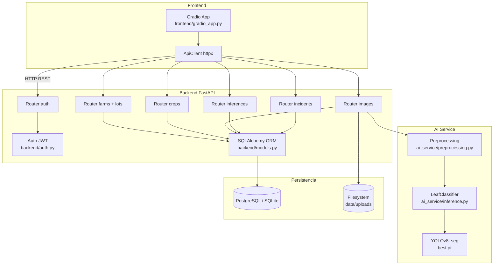

# Diagrama de componentes

## Notas de diseño

- La capa de IA está desacoplada del resto de la lógica de negocio: el endpoint de análisis solo conoce la interfaz `LeafClassifier.predict()`. Esto permite sustituir el modelo (por ejemplo, migrar a YOLOv11 o Mask R-CNN) sin tocar el backend ni el frontend.
- La capa de persistencia usa SQLAlchemy, lo que permite cambiar de SQLite (desarrollo) a PostgreSQL (producción) con solo cambiar `DATABASE_URL` en el `.env`.
- La autenticación se hace con JWT (python-jose) y las contraseñas se guardan hasheadas con bcrypt (passlib).
