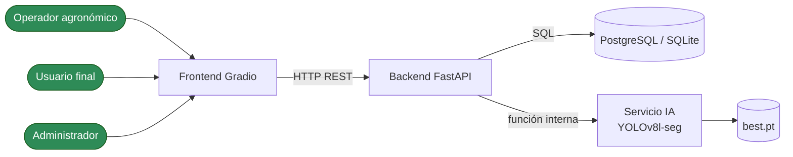

# Diagrama de contexto (C4 Nivel 1)

## Explicación

Tres tipos de actores humanos consumen el sistema a través del frontend web Gradio: un usuario final que carga imágenes y consulta su historial, un operador agronómico que gestiona fincas, lotes, cultivos e incidencias, y un administrador que además puede crear usuarios y ver toda la información del sistema. El frontend conversa por HTTP REST con el backend FastAPI, que persiste en una base relacional (PostgreSQL en producción, SQLite en desarrollo) y delega la inferencia al servicio de IA, el cual carga los pesos del modelo YOLOv8l-seg entrenado previamente.
