# Modelo de datos

```mermaid
erDiagram
    USER ||--o{ FARM : "posee"
    USER ||--o{ IMAGE : "sube"
    FARM ||--o{ LOT : "contiene"
    LOT ||--o{ CROP : "siembra"
    CROP ||--o{ IMAGE : "tiene"
    IMAGE ||--o{ INFERENCE : "produce"
    INFERENCE ||--o{ INCIDENT : "genera"

    USER {
        int id PK
        string username UK
        string email UK
        string hashed_password
        string role "admin | operador | usuario"
        bool is_active
        datetime created_at
    }

    FARM {
        int id PK
        string name
        string location
        float area_ha
        int owner_id FK
        datetime created_at
    }

    LOT {
        int id PK
        int farm_id FK
        string name
        float area_m2
        text description
        datetime created_at
    }

    CROP {
        int id PK
        int lot_id FK
        string species
        string variety
        datetime planting_date
        datetime created_at
    }

    IMAGE {
        int id PK
        int crop_id FK "nullable"
        string file_path
        string original_filename
        int uploaded_by_id FK
        datetime uploaded_at
    }

    INFERENCE {
        int id PK
        int image_id FK
        string model_version
        int n_leaves_detected
        int n_sana
        int n_mancha
        int n_seca
        float avg_confidence
        float inference_time_ms
        string annotated_path
        text raw_detections_json
        bool expert_reviewed
        text expert_notes
        datetime created_at
    }

    INCIDENT {
        int id PK
        int inference_id FK
        string severity "baja | media | alta"
        string status "abierta | en_revision | cerrada"
        text description
        datetime created_at
        datetime closed_at
    }
```

## Reglas de negocio

- Cada inferencia guarda la versión del modelo (`model_version`) para trazabilidad.
- La severidad de una incidencia se calcula en base al ratio de hojas enfermas detectadas por la inferencia asociada.
- Al cerrar una incidencia (`status = cerrada`), se asigna `closed_at = now()`.
- Un usuario con rol `usuario` solo ve sus propias fincas, lotes, cultivos, imágenes, inferencias e incidencias. El `admin` ve todo.
